# الميثاق المعماري المؤسسي الشامل (Enterprise Architecture Blueprint)
## منظومة ERP مجموعة خالد السليم القابضة (`خالد السليم | Al-Sulaim`)
### Modular Architecture • DDD • State Machines • EDA • Idempotency • RBAC • Multi-Tenancy • OMS • Inventory • Payments • Ledger • Settlement • Dispatch • Real-Time • Audit • Observability

---

### 1. العمارة المعيارية والطبقات المؤسسية (Modular Architecture Topology)

تتبنى المنظومة نموذج **العمارة المعيارية الموجهة للمجالات (Modular Monolith / Modular Architecture)**، حيث تنقسم المنظومة إلى **9 أقسام إدارية معيارية** و**5 شركات تابعة معزولة** تشترك في **نواة مؤسسية موحدة (Shared Kernel)**:

```mermaid
graph TD
    subgraph Presentation_Layer ["طبقة العرض الموحدة (Mobbin Monochrome UI)"]
        Landing_Auth["بوابة التعريف والدخول المقسومة (LandingPage & LoginPage)"]
        App_Shell["الهيكل الموحد (Header + 9-Dept Sidebar + AppLauncher)"]
        Portals["البوابات المعزولة (العملاء • الوكلاء • الإيواء • كاس)"]
    end

    subgraph Security_Tenancy ["طبقة الحوكمة والعزل (RBAC & Multi-Tenancy)"]
        IAM_Engine["محرك السياسات والنطاقات (iamPolicyEngine.ts)"]
        Company_Ctx["عزل الكيانات الـ 5 (CompanyContext.tsx)"]
        PDPL_Guard["تعتيم البيانات الحساسة (pdplMasking.ts)"]
    end

    subgraph Core_Domains ["المجالات الوظيفية المستقلة (DDD Bounded Contexts)"]
        SAF_Domain["مجال الاستقدام ومساند (musanedLifecycleEngine.ts)"]
        YAQ_Domain["مجال التأجير والأسطول (fleetDispatchEngine.ts)"]
        TOP_Domain["مجال الفرز والتوظيف ATS (fleetDispatchEngine.ts)"]
        KAS_Domain["مجال منافسات اعتماد وكاس (tenderAnalyticsService.ts)"]
        DAR_Domain["مجال الإيواء ونقل الخدمات (shelterTransferStore.ts)"]
        OMS_Domain["مجال الطلبات والمتاجر (ecommerceSyncService.ts)"]
    end

    subgraph Financial_Kernel ["النواة المالية والضريبية (Financial & Tax Kernel)"]
        Inventory_Lock["حجز المخزون 15 دقيقة (inventoryReservationService.ts)"]
        Payment_Orch["تنسيق المدفوعات والـ Escrow (paymentOrchestratorService.ts)"]
        Idempotency["درع عدم التكرار (idempotencyService.ts)"]
        Ledger_Core["الأستاذ العام المزدوج (journalEngine.ts & automationEngine.ts)"]
        ZATCA_Core["الفوترة الإلكترونية ZATCA Phase 2 (zatcaPhase2Service.ts)"]
    end

    subgraph Event_Observability ["طبقة الأحداث، الرصد، والمزامنة الخلفية"]
        Outbox_Bus["صندوق الصادر التبادلي (domainEventBus.ts)"]
        Realtime_WS["البث اللحظي المعزول (realtimeSubscriptionService.ts)"]
        Offline_Q["طابور عدم الاتصال والتنفيذ الخلفي (offlineQueueService.ts)"]
        Audit_Monitor["التدقيق الأمني ورادار الأخطاء (securityAuditService.ts & errorMonitorService.ts)"]
    end

    Presentation_Layer --> Security_Tenancy
    Security_Tenancy --> Core_Domains
    Core_Domains --> Financial_Kernel
    Financial_Kernel --> Event_Observability
```

---

### 2. التصميم الموجه بالمجال (Domain-Driven Design — DDD)

تنقسم المنظومة إلى 6 سياقات محددة (`Bounded Contexts`) واضحة الحدود والمسؤوليات:
1. **سياق الاستقدام وعقود مساند (`RecruitmentContext` — `SAF`)**: [`src/services/musanedLifecycleEngine.ts`](src/services/musanedLifecycleEngine.ts) — يدير دورة حياة العقد، Webhooks منصة مساند، وحسابات الضمان والاسترداد النظامي.
2. **سياق التأجير المرن وتوجيه الأسطول (`RentalDispatchContext` — `YAQ`)**: [`src/services/fleetDispatchEngine.ts`](src/services/fleetDispatchEngine.ts) — يدير تسعير الباقات المرنة، جدولة الورديات، تحسين مسارات السائقين، والتحقق من التسليم برمز `OTP`.
3. **سياق الفرز الوظيفي واستقطاب الكفاءات (`AtsContext` — `TOP`)**: [`src/services/fleetDispatchEngine.ts`](src/services/fleetDispatchEngine.ts) — يدير التقييم المعياري للمرشحين التنفيذيين (`scoreHeadhuntCandidate`) وبنك السير الذاتية.
4. **سياق المنافسات الحكومية وسحابة اعتماد (`TendersContext` — `KAS`)**: [`src/services/kasEtmadSuiteService.ts`](src/services/kasEtmadSuiteService.ts) و[`src/services/tenderAnalyticsService.ts`](src/services/tenderAnalyticsService.ts) — يدير جداول الكميات (`BOQ`)، الضمانات البنكية (`createBankGuarantee`)، وتحليل الأسعار التاريخية.
5. **سياق مراكز الإيواء ونقل الخدمات (`ShelterContext` — `DAR`)**: [`src/services/shelterTransferStore.ts`](src/services/shelterTransferStore.ts) — يدير تسكين الوافدات، متابعة التجارب، ونقل الخدمات.
6. **السياق المالي والضريبي (`FinanceZatcaContext` — `SMACC`)**: [`src/services/accounting/journalEngine.ts`](src/services/accounting/journalEngine.ts)، [`src/services/accounting/automationEngine.ts`](src/services/accounting/automationEngine.ts)، و[`src/services/zatcaPhase2Service.ts`](src/services/zatcaPhase2Service.ts).

---

### 3. آلات الحالة المنتهية (Deterministic State Machines)

تخضع جميع الكيانات التشغيلية والمالية لآلات حالة منتهية حتمية تمنع تخطي المراحل الإلزامية:
- **آلة حالة عقد مساند (14 مرحلة في [`musanedLifecycleEngine.ts`](src/services/musanedLifecycleEngine.ts))**:
  `new_order -> candidate_selected -> musaned_contract_issued -> client_paid -> agency_delegated -> medical_passed -> visa_stamped -> flight_booked -> airport_arrived -> probation_active -> completed` (مع مسارات `disputed` و`cancelled_refund_pending -> cancelled_refunded`).
  - تحرس الدالة `validateStageTransition(currentStage, targetStage)` كل انتقال وترفض أي قفز غير نظامي (مثل محاولة الانتقال من `new_order` إلى `visa_stamped` قبل اجتياز `medical_passed`).
- **آلة حالة حجز المخزون ([`inventoryReservationService.ts`](src/services/inventoryReservationService.ts))**:
  `AVAILABLE -> SOFT_LOCKED (15m TTL) -> CONTRACTED`.
- **آلة حالة حساب الضمان ([`paymentOrchestratorService.ts`](src/services/paymentOrchestratorService.ts))**:
  `HELD_IN_ESCROW -> RELEASED_TO_AGENCY | REFUNDED_TO_CLIENT | SETTLED`.

---

### 4. العمارة الموجهة بالأحداث ونمط صندوق الصادر (Event-Driven Architecture — Outbox Pattern)

يطبق [`src/services/domainEventBus.ts`](src/services/domainEventBus.ts) نمط **Transactional Outbox** لضمان عدم ضياع أي حدث نطاقي:
- عند وقوع أي تغيير في الكيانات الأساسية، تُستدعى `publishDomainEvent` لحفظ الحدث في `domain_outbox_events` بحالة `PENDING` ثم بثه للمشتركين (`PROCESSING -> PROCESSED`).
- في حال فشل أي معالج، يُزاد عداد `retry_count` وتُعاد معالجته عبر `flushOutbox(companyId, maxRetries)`.
- تشمل الأحداث القياسية: `CONTRACT_CREATED`, `CONTRACT_STAGE_CHANGED`, `INVOICE_CLEARED`, `ESCROW_HELD`, `ESCROW_RELEASED`, `ESCROW_REFUNDED`, `SOFT_LEASE_ACQUIRED`, `SOFT_LEASE_EXPIRED`, `JOURNAL_ENTRY_POSTED`, `JOURNAL_ENTRY_REVERSED`, `BANK_GUARANTEE_ISSUED`, `ECOMMERCE_SYNC_COMPLETED`.

---

### 5. حصانة عدم التكرار (Idempotency Protocol)

يطبق [`src/services/idempotencyService.ts`](src/services/idempotencyService.ts) بروتوكول `Idempotency-Key` الصارم:
- تحسب الدالة `computePayloadHash` بصمة `FNV-1a` لحمولة الطلب.
- تضمن الدالة `executeWithIdempotency`:
  1. إذا أُعيد إرسال نفس `idempotencyKey` بنفس البيانات خلال فترة الصلاحية (`24h TTL`)، تُعاد الاستجابة المخزنة (`deduplicated: true`) دون إعادة تنفيذ الخصم أو القيد المحاسبي.
  2. إذا أُعيد استخدام نفس `idempotencyKey` مع بيانات مختلفة، يُرفض الطلب فوراً بخطأ `Idempotency Conflict`.

---

### 6. التحكم بالوصول المبني على الأدوار والنطاق (RBAC, ABAC & PDPL)

- **محرك السياسات ([`src/services/iamPolicyEngine.ts`](src/services/iamPolicyEngine.ts) & [`src/contexts/IamSessionContext.tsx`](src/contexts/IamSessionContext.tsx))**:
  - يطبق سياسة **Deny by Default** عبر 7 مستويات نطاق بيانات (`0: No Access`, `1: Own`, `2: Team`, `3: Department`, `4: Branch`, `5: Company`, `6: Group`).
  - يدعم تفويض الصلاحيات المؤقت (`IamDelegation`) وقواعد فصل المهام الرقابية (`Segregation of Duties - SoD`).
- **تعتيم البيانات الشخصية (`PDPL Masking` — [`src/utils/pdplMasking.ts`](src/utils/pdplMasking.ts))**:
  - يعمّي أرقام الهوية الوطنية، الجوازات، الآيبان، والجوالات تلقائياً للأدوار غير المخولة (`maskNationalId`, `maskPassport`, `maskIban`, `maskPhone`, `maskSensitiveRecord`).

---

### 7. تعدد الكيانات وعزل الشركات (Multi-Tenancy Isolation)

- تدير المنظومة 5 كيانات قانونية مستقلة (`SAF`, `YAQ`, `TOP`, `KAS`, `DAR`) بالإضافة لكيان المجموعة الأم (`all` — `GROUP_MASTER_ENTITY`) في [`src/contexts/CompanyContext.tsx`](src/contexts/CompanyContext.tsx).
- تتحقق الدالة [`authService.validateCompanyAccess`](src/services/authService.ts) من حدود الكيان عند تسجيل الدخول، وتقفل جلسة الموظف على شركته (`setLockedSessionCompany`)، وتمنع تسرب الوحدات الحصرية (`exclusiveToCompany: 'KAS'`).

---

### 8. نظام إدارة الطلبات ومزامنة القنوات (OMS — Order Management System)

- يدير [`src/services/ecommerceSyncService.ts`](src/services/ecommerceSyncService.ts) دورة الطلبات الواردة من المتاجر الإلكترونية (`SALLA`, `ZID`, `SHOPIFY`, `WOOCOMMERCE`) عبر `syncInboundOrder` ومزامنة الباقات الصادرة عبر `syncOutboundPackages` مع ربطها المرجعي الفوري (`ERP-ORD-...`) وبث حدث `ECOMMERCE_SYNC_COMPLETED`.

---

### 9. حجز المخزون والسير الذاتية (Inventory Reservation — 15-Minute Soft Lease)

- يطبق [`src/services/inventoryReservationService.ts`](src/services/inventoryReservationService.ts) قفل الحجز المؤقت لمدة 15 دقيقة (`SOFT_LEASE_DURATION_MS = 15 * 60 * 1000`):
  - `acquireSoftLease`: يحجز السيرة الذاتية أو العاملة مؤقتاً للمستفيد، ويمنع أي مستفيد آخر من حجزها خلال مهلة الـ 15 دقيقة.
  - `commitLease`: يحول الحجز المؤقت إلى عقد دائم (`CONTRACTED`) فور إتمام الدفع.
  - `releaseExpiredLeases`: يحرر الحجوزات المنتهية تلقائياً ويعيدها للمخزون المتاح مع بث حدث `SOFT_LEASE_EXPIRED`.

---

### 10. تنسيق المدفوعات والتحقق التشفيري (Payment Orchestration)

- يدعم [`src/services/paymentOrchestratorService.ts`](src/services/paymentOrchestratorService.ts) بوابات (`Moyasar`, `HyperPay`, `Geidea`) ووسائل الدفع (`Mada`, `ApplePay`, `Visa`, `MasterCard`, `SADAD`, `BankTransfer`).
- يتحقق `verifyWebhookSignature` من توقيع `HMAC-SHA256` عبر `computeHmacSha256Hex` (Web Crypto API) قبل قبول أي إشعار دفع.

---

### 11. دفتر الأستاذ العام المزدوج غير القابل للتعديل (Immutable Double-Entry Ledger)

- يطبق [`src/services/accounting/journalEngine.ts`](src/services/accounting/journalEngine.ts) و[`src/services/accounting/chartOfAccountsService.ts`](src/services/accounting/chartOfAccountsService.ts):
  1. **توازن القيد المزدوج**: رفض أي قيد يومية لا يتساوى فيه إجمالي المدين مع إجمالي الدائن (`Math.abs(totalDebit - totalCredit) > 0.001`) أو يقل عن طرفين.
  2. **حصانة `Append-Only`**: منع تعديل (`updateJournalEntry`) أو حذف (`deleteJournalEntry`) أي قيد مرحّل (`POSTED`).
  3. **القيد العكسي النظامي (`reverseJournalEntry`)**: إنشاء قيد عكسي (`REVERSAL`) يعكس أطراف المدين والدائن تلقائياً ويسم القيد الأصلي بالحالة `REVERSED` مع بث حدث `JOURNAL_ENTRY_REVERSED`.

---

### 12. التسويات، حساب الضمان، والفوترة الضريبية (Settlement, Escrow & ZATCA Phase 2)

- **حساب الضمان (`Escrow Accounting` — [`paymentOrchestratorService.ts`](src/services/paymentOrchestratorService.ts))**:
  - `holdInEscrow`: يودع صافي المبلغ في حساب التزامات الضمان (`2105`) وضريبة القيمة المضافة 15% في حساب (`2102`) مقابل النقدية (`1101`).
  - `releaseToAgencyAfterMedical`: يمنع تحرير عمولة الوكالة الخارجية (`2106`) أو إثبات إيراد الاستقدام (`4101`) إلا بعد توثيق اجتياز الفحص الطبي (`medicalCleared === true` ورقم تقرير طبي معتمد).
  - `refundFromEscrow`: يعكس التزام الضمان والضريبة ويرد كامل المبلغ للعميل عند الإلغاء النظامي.
- **الفوترة الإلكترونية ZATCA المرحلة الثانية ([`src/services/zatcaPhase2Service.ts`](src/services/zatcaPhase2Service.ts))**:
  - توليد XML مطابق لمعيار `UBL 2.1`، وحساب بصمة `SHA-256`، وربط الفواتير بسلسلة الهاش السابق (`chainZatcaInvoices` بدءاً من `ZATCA_GENESIS_PIH`)، وتوليد رمز `QR TLV Base64`.

---

### 13. التفويج وتحسين المسارات الجغرافية (Dispatch & Route Optimization)

- يطبق [`src/services/fleetDispatchEngine.ts`](src/services/fleetDispatchEngine.ts):
  - `calculateHaversineDistanceKm`: حساب المسافة الجغرافية الدقيقة بين نقطتي GPS.
  - `optimizeDriverRoute`: ترتيب زيارات السائق حسب الأقرب جغرافياً (`Nearest-Neighbor Geospatial Clustering`) لكل وردية (`MORNING_08_12`, `AFTERNOON_13_17`, `EVENING_18_22`) مع حساب المسافة الإجمالية والوقت المتوقع للوصول (`ETA`).
  - `verifyDeliveryOtp`: التحقق من رمز `OTP` للعميل لتأكيد تسليم العاملة ميدانياً.

---

### 14. الأحداث اللحظية والتنفيذ الخلفي (Real-Time Events & Background Sync)

- **البث اللحظي ([`src/services/realtimeSubscriptionService.ts`](src/services/realtimeSubscriptionService.ts))**:
  - `subscribeTenantOrders`: اشتراك لحظي معزول لكل شركة على قناة `tenant:[company_id]:orders`.
  - `subscribeContractMilestones`: اشتراك لحظي لتحديثات مراحل العقد على قناة `contract:[contract_id]:milestones`.
- **التنفيذ الخلفي وطابور عدم الاتصال ([`src/services/backgroundExecutionService.ts`](src/services/backgroundExecutionService.ts) & [`src/services/offlineQueueService.ts`](src/services/offlineQueueService.ts))**:
  - مزامنة خلفية تلقائية عبر نبض `Web Worker` و`Service Worker Background Sync` ومزامنة شارة الإشعارات مع [`src/stores/appStore.ts`](src/stores/appStore.ts).

---

### 15. سجلات التدقيق الأمني والرقابي (Audit Logs & Anomaly Detection)

- يطبق [`src/services/securityAuditService.ts`](src/services/securityAuditService.ts) و[`iamPolicyEngine.logAudit`](src/services/iamPolicyEngine.ts):
  - تصنيف الأحداث الأمنية (`classifySecurityEvent` إلى `info`, `warning`, `critical`).
  - كشف الشذوذ الآلي (`detectAnomalies`) لرصد هجمات `BRUTE_FORCE` (5+ محاولات فاشلة من نفس الـ IP) وعمليات `DATA_EXPORT` المكثفة.
  - التحقق من القائمة البيضاء لعناوين الشبكة (`isIPAllowed` مع دعم نطاقات `CIDR /24`).

---

### 16. المراقبة والتشخيص والاستشفاء الذاتي (Observability & Self-Healing)

- يطبق [`src/services/errorMonitorService.ts`](src/services/errorMonitorService.ts) و[`src/components/monitoring/EnterpriseErrorMonitorPanel.tsx`](src/components/monitoring/EnterpriseErrorMonitorPanel.tsx):
  - التقاط وتصنيف أخطاء وقت التشغيل، وشجرة `React 19 Fiber`، والحزم الديناميكية، والشبكة، والربط الحكومي مع التكامل المباشر مع `@sentry/react`.
  - محرك استشفاء ذاتي (`autoHealed`) يعيد مزامنة شجرة المكونات ويفعل طبقة البيانات الهجينة تلقائياً، بالإضافة إلى فحص صحة المنظومة عبر [`realtimeSubscriptionService.checkSystemHealth`](src/services/realtimeSubscriptionService.ts).
