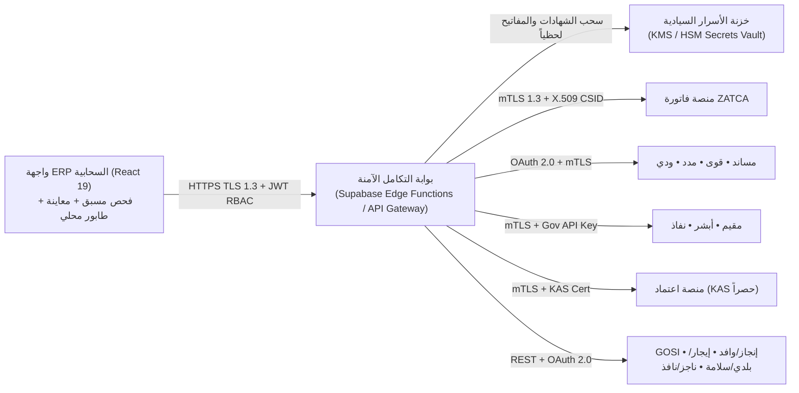

# الخطة الهندسية والتنظيمية الشاملة للربط والتكامل الحكومي الموحد
## منظومة تخطيط الموارد المؤسسية (`ERP`) — مجموعة خالد السليم القابضة (`SAF` • `YAQ` • `TOP` • `KAS` • `DAR`)

- **الإصدار المعماري:** `v3.0 — Enterprise Sovereign Integration Blueprint`
- **النطاق المؤسسي:** الشركات الخمس التابعة للمجموعة مع تطبيق العزل السيادي التام بين الكيانات (`Row-Level Security & Zero Cross-Tenant Contamination`)
- **المرجعيات التنظيمية:** هيئة الحكومة الرقمية (`DGA`)، الهيئة السعودية للبيانات والذكاء الاصطناعي (`SDAIA - PDPL`)، البنك المركزي السعودي (`SAMA`)، هيئة الزكاة والضريبة والجمارك (`ZATCA`)، وزارة الموارد البشرية والتنمية الاجتماعية (`HRSD`)، وزارة الداخلية (`MOI`)، وزارة الخارجية (`MOFA`)، وزارة المالية (`MOF`)، وزارة الشؤون البلدية والقروية والإسكان (`MOMRAH`)، ووزارة العدل (`MOJ`).

---

## 1. الملخص التنفيذي ومصفوفة الكيانات الخمسة

تهدف هذه الوثيقة إلى تأطير المعمارية الهندسية والأمنية والتشغيلية لربط نظام `ERP` مجموعة خالد السليم القابضة مع **11 منظومة ومنصة حكومية سعودية سيادية** عبر «مركز التكامل والربط الحكومي الموحد» (`GovIntegrationHub`)، بما يضمن أتمتة دورة العمل من التعاقد والفوترة وحماية الأجور وحتى التوثيق العدلي والإيواء والمنافسات الحكومية دون أي تداخل في البيانات أو المفاتيح التشفيرية بين الشركات.

### مصفوفة نطاق الربط حسب الكيان القانوني (`Multi-Entity Scope Matrix`)

| الكود | الكيان القانوني | النشاط الأساسي | الجهات الحكومية المرتبطة مباشرة | قاعدة العزل السيادي (`Isolation Rule`) |
| :--- | :--- | :--- | :--- | :--- |
| **`SAF`** | شركة السفير الماسي للاستقدام | استقدام العمالة المنزلية والمهنية وعقود التوسط | مساند، ZATCA، مدد/WPS، قوى، GOSI، مقيم/أبشر، إنجاز/وافد، إيجار/بلدي/سلامة، نفاذ/PDPL، ناجز/ودي/نافذ | معزولة تماماً بمفاتيح تشفير وشهادات `CSID` مستقلة؛ يُحظر وصولها لبيانات منافسات `KAS` |
| **`YAQ`** | شركة ياقوت نجد لتشغيل الكوادر والتأجير | عقود التأجير الشهري والمرن وتشغيل الكوادر | مساند، ZATCA، مدد/WPS، قوى (أجير/نقل خدمات)، GOSI، مقيم/أبشر، إيجار/بلدي/سلامة، نفاذ/PDPL، ناجز/ودي/نافذ | دفتر أستاذ عام مستقل وحسابات حماية أجور `WPS` مستقلة لكل منشأة |
| **`TOP`** | شركة توباز للاستقدام والتشغيل | استقطاب الكفاءات والوكالات الدولية والاستقدام | مساند، ZATCA، مدد/WPS، قوى، GOSI، مقيم/أبشر، إنجاز/وافد، إيجار/بلدي/سلامة، نفاذ/PDPL، ناجز/ودي/نافذ | قناة `Webhooks` مستقلة ومفاتيح تفويض خارجي معزولة |
| **`KAS`** | شركة كاس للتجارة والمنافسات | المنافسات الحكومية، التوريدات، المعرض التجاري، وقطاع الأميال | **اعتماد (`Etimad`) حصرياً**، ZATCA، مدد/WPS، قوى، GOSI، مقيم/أبشر، إيجار/بلدي/سلامة، نفاذ/PDPL، ناجز/نافذ | **كيان تجاري مستقل كلياً**؛ لا يرتبط بمنظومات الاستقدام أو مساند أو الإيواء إطلاقاً |
| **`DAR`** | شركة دار الرواد لمراكز الإيواء واللوجستيات | مراكز الإيواء (`Ewaa`)، الإعاشة، الترحيل، والاستقدام المساند | إيجار/بلدي/سلامة (تراخيص السكن الجماعي والإيواء)، مساند، مقيم/أبشر (الخروج النهائي والترحيل)، ZATCA، مدد/WPS، قوى، GOSI، نفاذ/PDPL، ناجز/ودي | رقابة صارمة على الطاقة الاستيعابية وتراخيص الدفاع المدني والسلامة وفحوصات الإعاشة |

---

## 2. التفصيل الهندسي والتنظيمي للجهات الحكومية الـ 11

### 2.1 منصة مساند (`Musaned` — وزارة الموارد البشرية والتنمية الاجتماعية `HRSD`)
- **النطاق التشغيلي:** الكيانات المرخصة للاستقدام والتشغيل (`SAF`, `YAQ`, `TOP`, `DAR`).
- **الخدمات المؤتمتة:**
  1. **توثيق عقود الاستقدام الموحدة:** استقبال وإصدار عقود التوسط والتأجير، والتحقق من أهلية العميل ورقم العقد القياسي (`MSN-YYYY-XXXXXX`).
  2. **محفظة الضمان المالي لمدة 90 يوماً (`Escrow Hold`):** تقييد مبالغ العقود آلياً في حساب أمانات مساند الوسيط (`2105`) وعدم الاعتراف بالإيراد النهائي إلا بعد إتمام فترة التجربة النظامية (90 يوماً) أو معالجة التسوية التناسبية عند الإرجاع وفق لائحة العمالة المنزلية.
  3. **التأشيرات البديلة والتأمين الإلزامي (24 شهراً):** أتمتة طلبات التأشيرة التعويضية عند رفض العمل أو عدم اللياقة الطبية، وربط وثيقة التأمين على عقد العمالة المنزلية.
  4. **إدارة الشكاوى والعودة والاسترداد:** استقبال إشعارات نزاعات مساند عبر `Webhooks` موقعة بـ `HMAC-SHA256` مع حساب الاسترداد النظامي آلياً (`musanedLifecycleEngine`).
- **بروتوكول الربط:** `REST JSON over mTLS 1.3 + OAuth 2.0 Client Credentials` (مفاتيح مستقلة لكل شركة في خزنة الخادم).

### 2.2 هيئة الزكاة والضريبة والجمارك (`ZATCA` — الفوترة الإلكترونية «فاتورة» المرحلة الثانية)
- **النطاق التشغيلي:** كافة الكيانات الخمسة (`SAF`, `YAQ`, `TOP`, `KAS`, `DAR`) لكل رقم تسجيل ضريبي مستقل أو مجموعة ضريبية (`15` رقماً يبدأ وينتهي بـ `3`).
- **المتطلبات التشفيرية والفنية المطبقة:**
  1. **إصدار طلب شهادة التشفير (`CSR`) وشهادات الامتثال والإنتاج (`CCSID / PCSID`):** توليد الزوج التشفيري لمنحنى إهليلجي (`ECDSA secp256k1`) على الخادم الآمن واستخراج شهادة `X.509 CSID` لكل وحدة فوترة (`EGS Unit`).
  2. **بناء الفاتورة القياسية (`UBL 2.1 XML`):** تضمين المعرف العالمي الفريد (`UUID v4`)، عداد الفواتير غير القابل للتلاعب (`ICV`)، وتجزئة الفاتورة السابقة (`PIH - Previous Invoice Hash` بترميز `SHA-256`).
  3. **التوقيع الرقمي والختم التشفيري (`Cryptographic Stamp`):** توقيع تجزئة `XML` القانونية (`Canonical XML C14N`) وبناء رمز الاستجابة السريعة `TLV Base64 QR` بالحقول التسعة (اسم المورد، الرقم الضريبي، الطابع الزمني `ISO-8601`، إجمالي الفاتورة شاملاً الضريبة بعملة `⃁`، إجمالي ضريبة القيمة المضافة `15%`، تجزئة XML، التوقيع الرقمي، المفتاح العام، وختم الشهادة).
  4. **قنوات الإرسال اللحظي:**
     - **`Clearance API` (`B2B` الفواتير الضريبية):** الاعتماد المسبق المتزامن قبل تسليم الفاتورة للمشتري الخاضع للضريبة.
     - **`Reporting API` (`B2C` الفواتير الضريبية المبسطة والإشعارات الدائنة/المدينة):** الإبلاغ خلال أقل من 24 ساعة من الإصدار.

### 2.3 منصة مدد ونظام حماية الأجور (`Mudad & WPS` — `HRSD` & `SAMA`)
- **النطاق التشغيلي:** كافة الكيانات الخمسة (`SAF`, `YAQ`, `TOP`, `KAS`, `DAR`).
- **الخدمات المؤتمتة:**
  1. **توليد ورفع ملفات `SIF 4.0` القياسية:** بناء سجل رأس المنشأة (`EDR/HDR`) وسجلات تفاصيل الموظفين (`SCR`) متضمنة الراتب الأساسي، بدل السكن، البدلات الأخرى، الاستقطاعات القانونية (بسقف المادة 92 لا يتجاوز 50%)، وصافي الأجر المطابق للمعادلة:
     $$\text{Net Salary} = \text{Basic} + \text{Housing} + \text{Transport} + \text{Other} - \text{Deductions} - \text{GOSI}$$
  2. **التحقق المسبق البنكي:** فحص رقم الآيبان السعودي (`^SA\d{22}$` مع خوارزمية `MOD-97`) ومطابقة رقم الهوية الوطنية أو الإقامة (`^[12]\d{9}$`) ورمز البنك لدى `SAMA`.
  3. **الربط المباشر عبر مدد (`Mudad Payroll API`):** رفع مسيرات الأجور ومتابعة مؤشر الالتزام الشهري ومعالجة التبريرات الإلكترونية للفروقات.

### 2.4 منصة قوى (`Qiwa` — وزارة الموارد البشرية والتنمية الاجتماعية)
- **النطاق التشغيلي:** كافة الكيانات الخمسة (`SAF`, `YAQ`, `TOP`, `KAS`, `DAR`).
- **الخدمات المؤتمتة:**
  1. **توثيق عقود العمل الإلكترونية:** مزامنة بيانات عقود الموظفين السعوديين وغير السعوديين وبنود الأجر وساعات العمل وفترة التجربة وإشعارات الإنهاء.
  2. **نقل الخدمات وإعارة العمالة (`Ajeer`):** أتمتة طلبات نقل الكفالة/الخدمات وتصاريح «أجير» لعقود التشغيل في `YAQ` و`SAF`.
  3. **مؤشر نطاقات (`Nitaqat`) وشهادات التوطين:** قراءة نسب التوطين اللحظية والتنبيه الاستباقي قبل هبوط النطاق الأخضر/البلاتيني، وتحديث لوائح تنظيم العمل المعتمدة.

### 2.5 المؤسسة العامة للتأمينات الاجتماعية (`GOSI — التأمينات الاجتماعية`)
- **النطاق التشغيلي:** كافة الكيانات الخمسة (`SAF`, `YAQ`, `TOP`, `KAS`, `DAR`).
- **الخدمات المؤتمتة:**
  1. **تسجيل واستبعاد المشتركين آلياً:** إشعار المباشرة فور توقيع العقد وإشعار الاستبعاد عند انتهاء العلاقة التعاقدية وتصفية نهاية الخدمة (`EOSB` وفق المادتين 84 و85).
  2. **احتساب ومطابقة الاشتراكات الشهرية:** تطبيق نسب فرع المعاشات، نظام «ساند» للتعطل عن العمل، وفرع الأخطار المهنية (`2%`) مع مراعاة سقف الأجر الخاضع للاشتراك (`45,000 ⃁`) والإصلاحات التدريجية للمشتركين الجدد.
  3. **شهادة الالتزام التأميني:** الاستعلام الدوري عن صلاحية شهادة التأمينات الاجتماعية اللازمة لصرف مستخلصات `اعتماد` وتجديد التراخيص.

### 2.6 منصة مقيم وأبشر أعمال (`Muqeem / Absher Business` — المديرية العامة للجوازات `MOI`)
- **النطاق التشغيلي:** كافة الكيانات الخمسة (`SAF`, `YAQ`, `TOP`, `KAS`, `DAR`).
- **الخدمات المؤتمتة:**
  1. **إصدار وتجديد هوية مقيم (`Iqama`):** الربط مع رقم الحدود (`Border Number`) فور وصول العامل للمطار والفحص الطبي لإصدار الإقامة وتجديدها.
  2. **تأشيرات السفر والترحيل:** إصدار تأشيرات الخروج والعودة (مفردة/متعددة) وتأشيرات الخروج النهائي (مربوطة بمحضر إخلاء الطرف وتسليم العهد ومغادرة مركز الإيواء في `DAR`).
  3. **نقل معلومات الجوازات ورادار الوثائق:** تحديث أرقام الجوازات المجددة وتشغيل رادار تنبيهات الانتهاء الاستباقي (`60 / 30 / 7` أيام).

### 2.7 منصة إنجاز وقُدوم ووزارة الخارجية ووافد (`Enjaz / Qudum / MOFA / Wafid`)
- **النطاق التشغيلي:** كيانات الاستقدام والوكالات الدولية (`SAF`, `TOP`, `DAR`).
- **الخدمات المؤتمتة:**
  1. **التفاويض الإلكترونية للوكالات الخارجية:** إصدار التفويض الإلكتروني لمكاتب الإرسال المعتمدة في دول الاستقدام ومصادقة الغرف التجارية إلكترونياً.
  2. **ربط الفحص الطبي المسبق (`Wafid / GAMCA`):** التحقق الآلي من شهادة اللياقة الطبية للعامل قبل تفييز الجواز لمنع وصول عمالة غير لائقة طبياً.
  3. **تتبع التفييز وبيانات القدوم:** مراقبة حالة ختم التأشيرة بالسفارة السعودية وربط بيانات رحلة الطيران ببوابة الاستقبال الميداني بالمطار.

### 2.8 منصة اعتماد (`Etimad` — وزارة المالية `MOF`)
- **النطاق التشغيلي:** **حصرياً شركة كاس للتجارة والمنافسات (`KAS`)** وفق قاعدة الفصل الصارم للأنظمة.
- **الخدمات المؤتمتة:**
  1. **المنافسات الحكومية وجداول الكميات (`BOQ`):** استيراد كراسات الشروط والمواصفات والرقم المرجعي للمنافسة (`ETM-YYYY-XXXXXX`) وتسعير بنود الكميات بدقة.
  2. **الضمانات البنكية الإلكترونية:** متابعة خطابات الضمان الابتدائي (`1%–2%`) والضمان النهائي (`5%`) وتواريخ سريانها ومطابقتها مع البنوك الضامنة.
  3. **المطالبات المالية وأوامر الدفع:** رفع المستخلصات والفواتير الضريبية المعتمدة من `ZATCA` ومطابقة أوامر الصرف الحكومية في الحسابات البنكية لشركة `KAS`.

### 2.9 منصة إيجار وبلدي وسلامة (`Ejar / Balady / Salamah` — `MOMRAH` والدفاع المدني)
- **النطاق التشغيلي:** مقرات الفروع لكافة الشركات، وبأولوية قصوى لمراكز الإيواء والسكن العمالي في شركة دار الرواد (`DAR`).
- **الخدمات المؤتمتة:**
  1. **توثيق عقود الإيجار الموحدة (`Ejar`):** ربط أرقام عقود الإيجار التجارية والسكنية بمراكز التكلفة وجدولة الدفعات الإيجارية والاستحقاقات المحاسبية.
  2. **تراخيص البلدية واشتراطات السكن الجماعي للأفراد (`Balady`):** مطابقة المساحة المترية والطاقة الاستيعابية للغرف والأسرة في مراكز الإيواء (`ewaaHousingEngine`) مع اشتراطات وزارة الشؤون البلدية والقروية والإسكان.
  3. **تراخيص الدفاع المدني (`Salamah`):** مراقبة صلاحية شهادة السلامة الوقائية وأنظمة الإنذار والإطفاء وعقود الصيانة الدورية لمقرات الإيواء والفروع.

### 2.10 النفاذ الوطني الموحد وسدايا (`Nafath IAM & SDAIA PDPL`)
- **النطاق التشغيلي:** كافة الكيانات الخمسة وبوابات العملاء والموظفين (`SAF`, `YAQ`, `TOP`, `KAS`, `DAR`).
- **الخدمات والضوابط المؤتمتة:**
  1. **التحقق البيومتري الثنائي عبر نفاذ (`Nafath OIDC`):** التحقق الموثق من هوية العميل أو المفوض النظامي عند توقيع العقود الإلكترونية وسندات لأمر وإخلاء الطرف.
  2. **الامتثال الكامل لنظام حماية البيانات الشخصية السعودي (`PDPL`):**
     - **توطين البيانات السيادي (`Data Residency`):** استضافة قواعد البيانات والملفات والنسخ الاحتياطية حصرياً داخل مراكز بيانات سحابية معتمدة داخل المملكة العربية السعودية.
     - **إخفاء البيانات الحساسة (`Masking` — المادة 11):** حجب أرقام الهوية/الإقامة، الجوازات، الآيبان، وأرقام الجوال لغير الأدوار المخولة (`pdplMasking.ts`) وتنقية سجلات الرصد (`Telemetry Scrubbing`).
     - **حقوق صاحب البيانات وسجل الموافقات:** توثيق موافقات المعالجة الصريحة، إشعارات الخصوصية، وحق العدول وإتلاف البيانات عند انتهاء الغرض النظامي.

### 2.11 منصة ناجز وودي ونافذ (`Najiz / Widdy / Nafith` — وزارة العدل `MOJ` و`HRSD`)
- **النطاق التشغيلي:** الإدارات القانونية والائتمانية والموارد البشرية في كافة الكيانات (`SAF`, `YAQ`, `TOP`, `KAS`, `DAR`).
- **الخدمات المؤتمتة:**
  1. **التحقق من الوكالات الشرعية والتراخيص العدلية (`Najiz`):** التحقق اللحظي من سريان الوكالة الإلكترونية وصلاحيات الوكيل الشرعي قبل إبرام عقود الشركات أو التسويات المالية.
  2. **التسوية الودية للمنازعات العمالية (`Widdy`):** ربط ملفات القضايا العمالية ومواعيد الجلسات ومحاضر الصلح المعتمدة بملف العامل أو الموظف والقيود المالية المترتبة عليها.
  3. **السندات التنفيذية وسندات لأمر (`Nafith`):** إصدار وتوثيق ومتابعة سندات لأمر للعقود الآجلة وعقود التوريد والتأجير للشركات مع تتبع حالة الاستحقاق والتنفيذ.

---

## 3. المعمارية الأمنية وشهادات الثقة (`Security, Certificates & Zero-Secret Architecture`)

### الضوابط الأمنية الإلزامية:
1. **حظر تخزين أي مفاتيح سرية في الكود المصدري أو المتصفح (`Zero Client-Side Secrets`):** لا يحتوي تطبيق الواجهة الأمامية إطلاقاً على أي مفاتيح خاصة (`Private Keys`) أو `Client Secrets` أو رموز وصول حكومية؛ يتم استدعاء البوابة الخلفية (`Edge Functions`) التي تسحب المفاتيح من خزنة الأسرار البيئية (`KMS / Vault`) لكل شركة (`SAF`, `YAQ`, `TOP`, `KAS`, `DAR`) على حدة.
2. **التحقق المتبادل بالشهادات (`Mutual TLS 1.3 & X.509 CSID`):** استخدام شهادات رقمية صادرة من المركز الوطني للتصديق الرقمي (`NCDC`) أو `ZATCA CA` مع تدوير دوري آلي للمفاتيح (`Key Rotation`) قبل 30 يوماً من الانتهاء.
3. **التحقق من تواقيع الـ Webhooks (`HMAC-SHA256 + Replay Guard`):** كل إشعار وارد من مساند أو نفاذ أو نافذ يخضع لفحص توقيع `X-Hub-Signature-256` مع نافذة طابع زمني لا تتجاوز `300` ثانية ومنع إعادة الإرسال عبر جدول `processed_webhook_ids`.
4. **عزل الصلاحيات المؤسسي (`RBAC + Tenant RLS`):** تقييد الوصول بـ `company_id` في سياسات `PostgreSQL RLS` مع فصل مهام الإعداد عن الاعتماد والإرسال الحكومي (`Segregation of Duties - SoD`).

---

## 4. جدول ربط الحقول مع جداول قاعدة البيانات الحالية (`Field-to-Database Mapping`)

| الجهة الحكومية | جدول ERP المصدري | الحقول الأساسية في ERP | الحقول المقابلة في حزمة الجهة الحكومية | قاعدة التحقق المسبق (`Pre-Flight Rule`) |
| :--- | :--- | :--- | :--- | :--- |
| **مساند (`Musaned`)** | `contracts`, `orders` | `musaned_number`, `client_national_id`, `maid_passport`, `amount`, `company_id` | `contractReference`, `employerId`, `workerPassportNo`, `escrowAmountSar`, `establishmentCode` | رقم عقد مساند صالح + هوية عميل `^[12]\d{9}$` + حظر `company_id = KAS` |
| **فاتورة (`ZATCA`)** | `zatca_invoices`, `finance_journals` | `id`, `uuid`, `seller_vat`, `total_amount`, `vat_amount`, `previous_hash` | `cbc:ID`, `cbc:UUID`, `CompanyID`, `TaxInclusiveAmount`, `TaxAmount`, `PIH`, `QR TLV` | رقم ضريبي `^3\d{13}3$` (15 رقماً) + توازن الضريبة `15%` + وجود `PIH` |
| **مدد (`Mudad WPS`)** | `employees`, `payroll_runs` | `national_id`, `iban`, `basic_salary`, `housing`, `deductions`, `net_salary` | `EDR/SCR`: `molId`, `employeeId`, `ibanNumber`, `basicWage`, `housingAllowance`, `netPay` | آيبان سعودي `^SA\d{22}$` + هوية/إقامة `^[12]\d{9}$` + مطابقة صافي الأجر |
| **قوى (`Qiwa`)** | `employees`, `sponsorship_transfers` | `national_id`, `job_title`, `contract_type`, `salary`, `transfer_status` | `laborContractId`, `workerId`, `occupationCode`, `wagePackage`, `transferRequestType` | هوية/إقامة `^[12]\d{9}$` + رمز مهنة قياسي + أجر لا يقل عن الحد النظامي |
| **التأمينات (`GOSI`)** | `employees`, `eos_settlements` | `national_id`, `is_saudi`, `basic_salary`, `housing`, `join_date` | `contributorNinOrIqama`, `nationalityType`, `contributoryWage`, `engagementDate` | سقف الأجر التأميني `<= 45,000 ⃁` + هوية/إقامة `^[12]\d{9}$` |
| **مقيم (`Muqeem`)** | `employees`, `cvs`, `flights` | `iqama_number`, `border_number`, `passport_number`, `iqama_expiry` | `residentId`, `borderNumber`, `passportNo`, `visaActionType`, `expiryDateHijriGregorian` | رقم إقامة `^2\d{9}$` أو رقم حدود 10 أرقام + صلاحية الجواز `>= 6` أشهر |
| **إنجاز ووافد (`Enjaz/Wafid`)** | `ingaz_delegations`, `cvs`, `offices` | `visa_number`, `office_license`, `maid_passport`, `medical_status` | `visaNumber`, `foreignAgencyCode`, `applicantPassport`, `wafidMedicalFitCode` | رقم تأشيرة 10 أرقام + حالة فحص وافد `FIT` + حظر `company_id = KAS` |
| **اعتماد (`Etimad`)** | `kas_tenders` (`TendersBOQ`) | `tender_ref`, `boq_total`, `bank_guarantee_no`, `claim_amount`, `company_id` | `tenderReferenceNo`, `financialOfferSar`, `guaranteeLetterRef`, `paymentOrderClaim` | **حصري لـ `KAS`** + رقم مرجعي لاعتماد صالح + شهادة الزكاة وGOSI سارية |
| **إيجار/بلدي/سلامة** | `shelter_inmates`, `cost_centers` | `shelter_branch`, `room_capacity`, `occupied_beds`, `ejar_contract_no` | `ejarContractNumber`, `baladyLicenseNo`, `salamahCertId`, `maxOccupancyLimit` | عدم تجاوز الطاقة الاستيعابية للغرفة + رقم عقد إيجار وترخيص سلامة سارٍ |
| **نفاذ و`PDPL`** | `clients`, `users`, `activity_logs` | `national_id`, `consent_signed`, `ip_address`, `masked_pii` | `nafathTransactionId`, `nationalId`, `assuranceLevel`, `pdplConsentRecordId` | هوية `^[12]\d{9}$` + توثيق موافقة `PDPL` + تشفير وإخفاء الحقول الحساسة |
| **ناجز/ودي/نافذ** | `complaints`, `contracts`, `rent_contracts` | `poa_number`, `dispute_id`, `promissory_note_no`, `claim_amount` | `agencyDeedNumber`, `widdyCaseNumber`, `nafithBondId`, `obligationAmountSar` | وكالة إلكترونية سارية أو سند لأمر مكتمل الأركان النظامية بالريال `⃁` |

---

## 5. آلية الطوابير والمزامنة الموثوقة (`Transactional Outbox, Retry & DLQ`)

لضمان عدم ضياع أي معاملة حكومية عند تذبذب الشبكة أو فترات الصيانة المجدولة للمنصات الحكومية، يعتمد المحرك نمط **صندوق الصادر التبادلي (`Transactional Outbox Pattern`)**:

1. **الفحص المسبق الصارم (`Pre-Flight Validation Gate`):** قبل إدراج أي حزمة في الطابور، يتحقق المحرك محلياً وخادمياً من صيغ الهويات، الأرقام الضريبية، الآيبان، أرقام العقود والتأشيرات، وعزل الشركات (`Tenant Isolation`). الحزم المخالفة تُرفض فوراً مع رسالة تصحيحية واضحة للموظف المختص.
2. **مفتاح عدم التكرار (`Idempotency Key`):** تُوسم كل عملية بمفتاح فريد حتمي (`SHA256(companyId + agencyId + entityId + operationType + version)`) يمنع إرسال نفس الفاتورة أو مسير الرواتب أو العقد مرتين حتى في حال انقطاع الاتصال بعد الإرسال.
3. **سياسة إعادة المحاولة الأُسّية (`Exponential Backoff with Jitter`):**
   - المحاولة 1: فورية (`0s`).
   - المحاولة 2 (عند أخطاء الشبكة أو `HTTP 429 / 502 / 503 / 504`): بعد `30` ثانية + تشتيت عشوائي (`Jitter`).
   - المحاولة 3: بعد `2` دقيقة.
   - المحاولة 4 والأخيرة: بعد `10` دقائق.
4. **طابور الرسائل المعزولة (`Dead Letter Queue — DLQ`):** عند استنفاد الحد الأقصى للمحاولات أو ورود رفض منطقي دائم (`HTTP 400 / 422 Schema Reject`)، تُعزل الحزمة في `DLQ_QUARANTINED` مع تنبيه فوري في مركز الإشعارات الموحد، وإتاحة زر «إعادة الجدولة بعد التصحيح» (`Replay from DLQ`) مع تسجيل كامل في سجل التدقيق الأمني.

---

## 6. خارطة الطريق التنفيذية ذات المراحل الأربع (`4-Phase Executive Roadmap`)

| المرحلة | الإطار الزمني | الجهات المستهدفة | المخرجات الهندسية ومعايير القبول (`Exit Criteria`) |
| :--- | :--- | :--- | :--- |
| **المرحلة الأولى (`Phase 1`)** الامتثال المالي والرواتب التأسيسي | الأسابيع `1 – 4` | **1. `ZATCA` (المرحلة الثانية)** **2. `Mudad & WPS`** **3. `GOSI`** | إصدار شهادات `CSID` للكيانات الخمسة، تفعيل `Clearance/Reporting` لحظياً بنسبة نجاح `99.9%`، أتمتة رفع ملفات `SIF 4.0` ومطابقة اشتراكات التأمينات الاجتماعية آلياً. |
| **المرحلة الثانية (`Phase 2`)** أتمتة الاستقدام وعقود العمل | الأسابيع `5 – 8` | **4. `Musaned`** **5. `Enjaz / MOFA / Wafid`** **6. `Qiwa`** | ربط دورة حياة عقد الاستقدام (14 حالة) ومحفظة ضمان 90 يوماً للشركات (`SAF`, `YAQ`, `TOP`, `DAR`)، أتمتة تفاويض إنجاز وفحص وافد، وتوثيق عقود قوى ومؤشر نطاقات. |
| **المرحلة الثالثة (`Phase 3`)** الجوازات والإيواء والمنافسات الحكومية | الأسابيع `9 – 12` | **7. `Muqeem / Absher`** **8. `Ejar / Balady / Salamah`** **9. `Etimad` (`KAS` حصراً)** | أتمتة إصدار/تجديد الإقامات وتأشيرات الخروج والعودة والنهائي، ربط تراخيص السكن الجماعي والسلامة لمركز الإيواء (`DAR`)، وتفعيل سحابة منافسات ومستخلصات اعتماد لشركة `KAS`. |
| **المرحلة الرابعة (`Phase 4`)** الهوية السيادية والمنظومة العدلية | الأسابيع `13 – 16` | **10. `Nafath IAM & PDPL`** **11. `Najiz / Widdy / Nafith`** | تفعيل التحقق الثنائي عبر نفاذ لتوقيع العقود، إتمام التدقيق الشامل لنظام `PDPL`، وأتمتة التحقق من الوكالات الإلكترونية ومحاضر ودي وسندات نافذ التنفيذية. |

---

## 7. حوكمة التشغيل، المراقبة، ومؤشرات الأداء (`SLA & Observability`)

- **مؤشر الجاهزية الحكومية الموحد (`Unified Readiness Score`):** يُقاس آلياً من `0%` إلى `100%` عبر فحص اكتمال السجلات الضريبية والتأمينية، صحة الهويات والآيبان، خلو طابور `DLQ` من الحزم المعزولة، وسريان الشهادات الرقمية.
- **اتفاقية مستوى الخدمة الداخلية (`Internal Integration SLA`):**
  - زمن استجابة الفحص المسبق وبناء الحزم محلياً: `< 50 ms`.
  - زمن الاعتماد الضريبي المتزامن (`ZATCA Clearance`): `< 3,000 ms`.
  - معالجة إشعارات `Webhooks` الواردة وتحديث القيود المحاسبية: `< 2,000 ms`.
- **التصدير والتقارير الرقابية:** يتيح المركز تصدير تقارير الجاهزية وسجلات المزامنة بصيغ `Excel (XLSX)`، `CSV (UTF-8 BOM)`، `PDF`، والتقارير الرسمية القابلة للطباعة مع الختم الرقمي للمجموعة ورمز الريال السعودي الرسمي (`⃁`).
